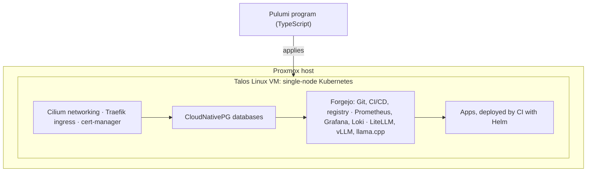

# Self-hosted platform

A self-hosted platform for personal apps and development work, run on one home server and defined entirely as code.

## What it does

- Hosts Git repositories with CI/CD pipelines and a container registry; a merge to an app's main branch builds and deploys that app.
- Runs PostgreSQL databases through an operator rather than hand-built database servers.
- Monitors the platform and its apps, and sends alerts and a daily heartbeat as push notifications.
- Takes layered backups.
- Offers single sign-on across its web interfaces.
- Serves local LLM inference on a dedicated GPU behind one gateway.

## How it is built

- **Infrastructure as code.** One Pulumi program in TypeScript creates the virtual machine, configures the Talos node and installs every platform component in dependency order. Re-running it brings the live system back to what the code declares.
- **Kubernetes on Talos.** A single-node cluster on Talos Linux, an immutable, API-driven operating system with no shell access. Cilium provides networking and load balancing, Traefik handles ingress and TLS.
- **Delivery.** Forgejo provides Git hosting, Forgejo Actions CI and an OCI registry inside the cluster. App pipelines build an image and deploy it with Helm.
- **Operations.** CloudNativePG manages the databases; Prometheus, Grafana, Loki and Alertmanager cover metrics, logs and alerts; Forgejo acts as the OpenID Connect provider for single sign-on. Renovate opens dependency update pull requests daily.
- **Local AI.** A GPU inference engine (vLLM or llama.cpp, selected by one setting) and a CPU llama.cpp server sit behind a LiteLLM gateway.

## Status

In daily use, with backups, dependency updates and health notifications running on daily schedules.
